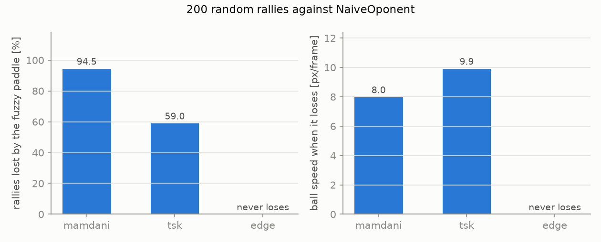
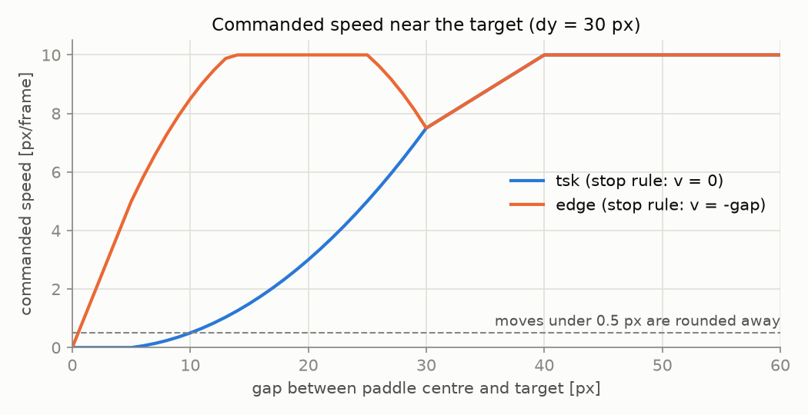
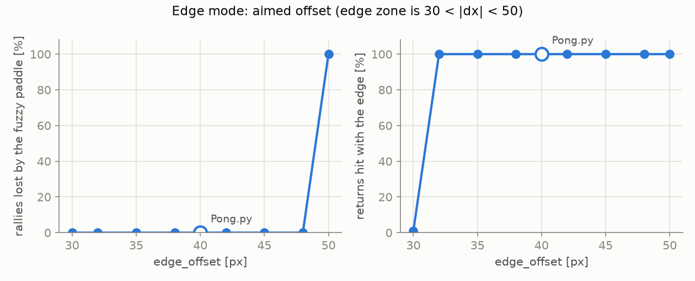
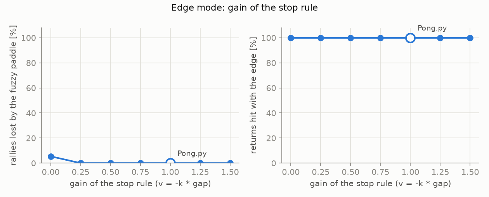
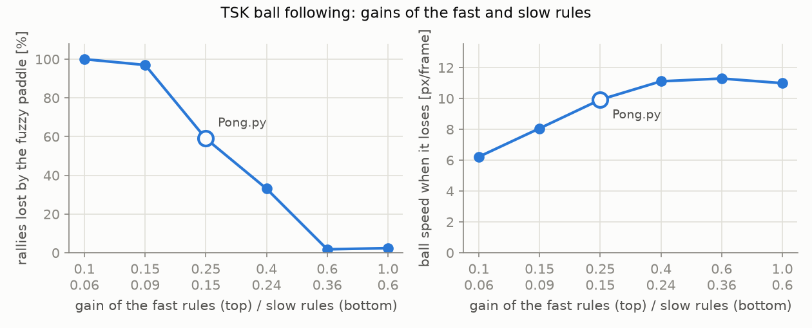
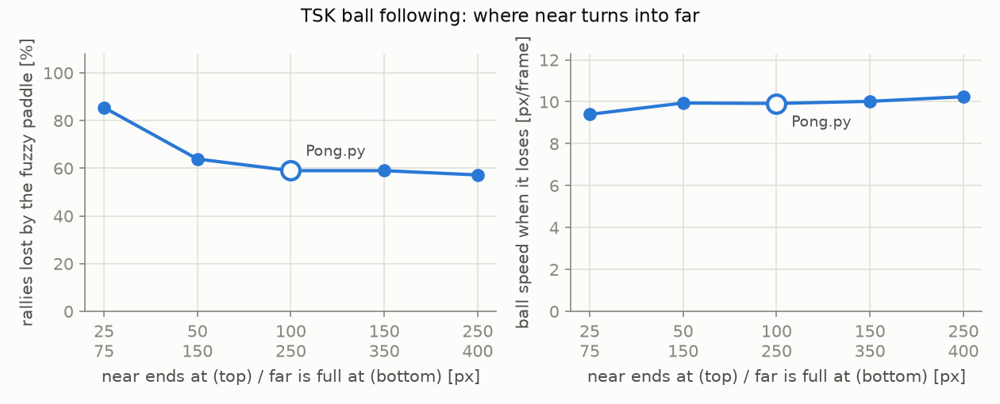

# Fuzzy Pong controllers: simulation report

This report measures the three controllers of `FuzzyPlayer` in `Pong.py` against the provided
`NaiveOponent`, and checks how much the results depend on the hard-coded values of the controller.
Every number below comes from the files in `results/`, produced by the scripts in this folder.

| controller | `method` | idea |
|---|---|---|
| Mamdani | `"mamdani"` | scikit-fuzzy, 6 rules, centroid defuzzification, follows the ball |
| TSK | `"tsk"` | hand-written first-order TSK (`v = -k * x_diff`), same 6 rules, follows the ball |
| Edge | `"edge"` | the TSK steered towards a target: the predicted impact point shifted by 40 px, so the ball hits the outer quarter of the paddle and speeds up by 10 % |

## Summary

- **The edge strategy never lost a rally once play had started**: 0 out of 166 decided rallies,
  against 59 % for the TSK and 94.5 % for Mamdani. It hits 100 % of its returns with the edge.
- **The impact prediction is exact while the ball comes down** (64 impacts out of 64, to the pixel).
- **Edge mode is insensitive to `edge_offset`**: every value from 32 to 48 px gives exactly the same
  games, because in this game the contact point changes the ball speed but not its direction.
  The two bounds of the edge zone behave as the geometry predicts (30 px: no speed-up, 50 px: miss).
- **The stop-rule gain of edge mode must be above 0**: with 0 the paddle stalls up to ~10 px short of
  its target and loses 5.4 % of the rallies; any gain from 0.25 to 1.5 loses none.
- **The TSK gains taken from the notebook (0.25 / 0.15) are not the best for ball following**:
  raising them to 0.6 / 0.36 cuts the rallies lost from 59 % to 1.8 %. `Pong.py` was not changed.
- **The near/far thresholds matter little** once "near" covers at least the bottom 100 px.

## 1. Method

### Simulation

`harness.py` runs `Pong.py` without a window and without modifying it:

- the SDL video driver is set to `dummy`, and each frame calls the same methods in the same order as
  `PongGame.run` (`ball.move`, then `act` for the opponent and for the fuzzy player);
- `pygame.time.get_ticks` is replaced by a frame counter (`frame * 1000 / FPS`), so the 120 ms
  collision cooldown of `Ball.move` keeps its length while the simulation runs much faster than real time;
- `Ball.reset` and `Ball.bounce_y_power` are wrapped to record who lost a point, the ball speed at that
  moment, and every hit with the outer quarter of a paddle;
- the wrapped `bounce_y_power` also caps the green channel of the ball colour, because the provided code
  raises it by 10 up to 260 and pygame then crashes (`invalid color argument`) on the 25th edge hit of a rally.

Environment: Python 3.14.8, pygame 2.6.1, scikit-fuzzy 0.5.0, numpy 2.3.5, FPS = 30, board 800 × 400
(`results/meta.json`).

### Two kinds of runs

- **Match**: the real game, from the real starting position, for 5 minutes of play. The game is
  deterministic, so a match replays the same rally after every point. It reproduces what you would see
  on screen.
- **Random rallies**: 200 rallies, each from a random ball position (x in 100..680, y in 150..230),
  random speed (3 to 6 px/frame) and horizontal direction, and random paddle positions. The ball always
  starts towards the opponent, so the fuzzy paddle always has time to get into place. A rally ends at
  the first point (or after 10 minutes, which never happened). **The same seed is used for every
  setting**, so all settings are compared on exactly the same 200 rallies.

### Measures

- **Rallies lost [%]**: rallies lost by the fuzzy paddle / rallies decided after the first pass.
  A rally lost on the very first pass, before the paddle that lost touched the ball, is a start
  artefact and is left out. With these starts it happened 34 times to the opponent (its paddle drawn
  too far from the ball) in every setting, and at most once to the fuzzy paddle with the values of
  `Pong.py`.
- **Ball speed when it loses**: horizontal ball speed, in px/frame, at the point lost by the fuzzy paddle.
  Both paddles move at most 10 px/frame.
- **Returns hit with the edge [%]**: fuzzy-paddle returns where the ball hit the outer quarter of the paddle.

## 2. Results with the values of `Pong.py`

### 2.1 Five-minute matches (`results/matches.json`)

| controller | points lost | points won | ball speed at each lost point | edge hits (player / opponent) |
|---|---|---|---|---|
| Mamdani | 4 | 1 | 8.56 | 1 / 60 |
| TSK | 4 | 1 | 10.36 | 6 / 62 |
| Edge | **0** | **9** | (none) | 72 / 63 |

`NaiveOponent` moves the *left side* of its paddle (`rect.x`) to the ball centre, so it hits almost
every ball with its edge: it speeds the ball up by itself, about every 6 s. Mamdani loses as soon as the
ball reaches 8.56 px/frame: its centroid output saturates around ±8.9 px/frame and its `slow` rules make
it fall behind while the ball is far. The TSK only loses above 10 px/frame, the paddle speed limit. Edge
mode wins every point, the opponent losing at 11.4–12.5 px/frame.

### 2.2 Random rallies (`results/baseline_rallies.json`)



| controller | rallies lost | ball speed when it loses (mean / min) | returns hit with the edge | mean rally length |
|---|---|---|---|---|
| Mamdani | 156 / 165 (94.5 %) | 7.98 / 6.52 | 9.3 % | 25.8 s |
| TSK | 98 / 166 (59.0 %) | 9.92 / 9.50 | 23.4 % | 30.5 s |
| Edge | **0 / 166 (0 %)** | (none) | **100 %** | 19.5 s |

Edge rallies are the shortest: both paddles now speed the ball up, and the opponent cannot follow
beyond 10 px/frame (11.3 px/frame on average when it loses).

### 2.3 Impact prediction (`results/prediction_accuracy.json`)

`predict_impact_x` replays `Ball.move` frame by frame (same rounding, same wall bounces) until the ball
reaches the paddle line. It was compared with the real impact point during a 5-minute match.

| prediction made… | impacts | exact | within 3 px | worst error |
|---|---|---|---|---|
| when the ball starts coming down | 64 | **64** | 64 | 0 px |
| when the ball starts going up | 64 | 29 | 53 | 577 px |

While the ball comes down nothing unknown is left, so the prediction is exact. While it goes up, the
replay assumes the opponent sends it straight back; when the opponent hits it with its edge, the ball
comes back 10 % faster and lands a few pixels further (63 out of 64 within 14 px). The single 577 px
error is most likely the point lost by the opponent during this match (it was run in `tsk` mode): the
ball is then reset to the centre, which no prediction can know. This is why edge mode only waits under the predicted point while
the ball goes up, and aims at the edge only once it comes down.

### 2.4 Dead zone near the target (`results/dead_zone.csv`)



pygame stores the paddle position as whole pixels and rounds every move, so a commanded speed under
0.5 px/frame is lost. With the ball-following consequents (`stop` rule: v = 0), the TSK commands
`v = -0.01 * gap * (gap - 5)` for gaps between 5 and 30 px (and 0 below 5 px), which drops under 0.5 px/frame below a 10 px gap:
the paddle stalls up to 10 px short of its target. That is harmless when following the ball, but the
edge zone is only ±9 px wide around 40 px. Edge mode therefore uses `v = -gap` for its `stop` rule,
which closes the remaining gap in one frame.

## 3. Sensitivity of the hard-coded values

Each study changes **one** value, keeps everything else as in `Pong.py`, and replays the same 200
random rallies. The settings are applied to the player object after it is created (`run_experiments.py`).

### 3.1 `edge_offset` in edge mode (`results/sweep_edge_offset.csv`)



| edge_offset [px] | 30 | 32 – 48 | 50 |
|---|---|---|---|
| rallies lost | 0 % | **0 %** (all identical) | all 166 (164 on the first pass, before any return) |
| returns hit with the edge | 1 % | **100 %** | (no returns) |
| mean rally length | 36.3 s | 19.5 s | 7.5 s |

- From 32 to 48 px the results are **identical to the last digit**. In `Ball.move` the contact point only
  decides whether the ball speeds up; it never changes the direction of the ball. As long as every
  return is an edge hit, the trajectory is the same whatever the offset.
- The bounds confirm the geometry computed from the code: at exactly 30 px the ball touches the paddle
  but not its outer quarter (the test is strict), and at exactly 50 px it misses the paddle.
- **Why 40**: in simulation the margin is never used, because the prediction and the alignment are exact.
  40 px keeps the largest margin (9 px on each side, in whole pixels) against anything the simulation does
  not cover, such as a paddle stopped a few pixels short by `Racket.move` near a wall.

### 3.2 Gain of the `stop` rule in edge mode (`results/sweep_edge_stop_gain.csv`)



| stop gain | 0 | 0.25 – 1.5 |
|---|---|---|
| rallies lost | 9 / 166 (5.4 %) | **0** (all identical) |

With gain 0 (the ball-following `stop` rule) the dead zone of §2.4 makes the paddle lose 9 rallies
(ball at 10.6 px/frame on average, 9.6 at the slowest). Any positive gain removes the dead zone: even 0.25 closes a quarter of the
gap per frame and leaves at most ~2 px of error, well inside the ±9 px margin. **Why 1**: it lands
exactly on the target in one frame (a "deadbeat" proportional step); gains between 1 and 2 overshoot
and settle, and above 2 the paddle would oscillate with a growing amplitude.

### 3.3 Gains of the `fast` / `slow` rules in TSK ball following (`results/sweep_gains.csv`)



| fast / slow | 0.1 / 0.06 | 0.15 / 0.09 | **0.25 / 0.15** | 0.4 / 0.24 | 0.6 / 0.36 | 1.0 / 0.6 |
|---|---|---|---|---|---|---|
| rallies lost | 100 % | 97 % | **59 %** | 33 % | **1.8 %** | 2.4 % |
| ball speed when it loses | 6.2 | 8.1 | **9.9** | 11.1 | 11.3 | 11.0 |
| returns hit with the edge | 77 % | 61 % | **23 %** | 11 % | 1.8 % | 2.0 % |

The values of `Pong.py` come from the notebook (cell 28). They are not the best for following the ball:
with low gains the paddle lags behind, hits the ball with its edge without meaning to, speeds the ball
up itself and then cannot catch it. From 0.6 / 0.36 the paddle stays centred under the ball, almost
never speeds it up, and the opponent, who speeds it up with its own edge, loses first. Above that, the
results do not improve (the 1.8 % / 2.4 % difference is 3 rallies against 4). **`Pong.py` still uses the
notebook values**; switching to 0.6 / 0.36 is a one-line change in `velocity_fx` if wanted. Its effect on
edge mode, which reuses these gains far from the target, has not been measured.

### 3.4 Thresholds of `near` / `far` in TSK ball following (`results/sweep_near_far.csv`)



`near` is 1 up to the first value and 0 from the second; `far` is its mirror image.

| near ends / far full [px] | 25 / 75 | 50 / 150 | **100 / 250** | 150 / 350 | 250 / 400 |
|---|---|---|---|---|---|
| rallies lost | 85.5 % | 63.9 % | **59.0 %** | 59.0 % | 57.2 % |
| ball speed when it loses | 9.4 | 9.9 | **9.9** | 10.0 | 10.2 |

A small `near` zone hurts: the `slow` rules then drive the paddle for most of the ball's flight and it
falls behind. From 100 / 250 on, the curve is almost flat (59 % → 57 %). The values of `Pong.py` sit at
the start of that plateau. The result also says that against this opponent the `slow` rules do not help
ball following; they are kept because the rule table of the assignment uses both distances.

## 4. Where each hard-coded value comes from

| value | origin | evidence in this report |
|---|---|---|
| universes x ±800, y 0..400, v ±10 | board size and `Racket.max_speed` | (definition) |
| edge zone 30 < \|dx\| < 50 | paddle 80 px, ball 20 px, `width // 4` test in `Ball.move` | §3.1: 30 gives no speed-up, 50 misses |
| `edge_offset = 40` | middle of the edge zone | §3.1: any value 32–48 is equivalent; 40 keeps the largest margin |
| edge `stop` gain = 1 | removes the dead zone, deadbeat step | §2.4, §3.2: 0 loses 5.4 %, 0.25–1.5 lose nothing |
| output sets of Mamdani, rule table | notebook, cells 17–19 and 26 | §2.1–2.2 |
| gains 0.25 / 0.15 | notebook, cell 28 | §3.3: works, but 0.6 / 0.36 follows the ball better |
| `centre` triangle ±30 | notebook, cell 15; matches the start of the edge zone | not swept |
| `near` / `far` at 100 / 250 px | judgement: "near" is about the bottom quarter of the board | §3.4: start of the plateau |

## 5. Limits

- **One opponent**: every result is against `NaiveOponent`. Two edge players against each other are
  shown in `../edge_vs_edge.py`, not measured here.
- **Deterministic game**: matches replay the same rally after each point; the random rallies are there to
  cover other situations, 200 per setting.
- **Simulated clock**: the real game ticks at about 30 FPS but not exactly, which can change the
  120 ms collision cooldown by a frame. Its effect was not studied.
- **Not swept**: the Mamdani output sets (a narrower `fast` set would push its ±8.9 px/frame limit closer to
  10), the width of the `centre` triangle, and the gains of edge mode far from the target.
- **Two flaws of the provided code** (above "DO NOT MODIFY", so not fixed in `Pong.py`): the ball colour
  crash on the 25th edge hit of one rally, and a ball faster than 20 px/frame (the paddle thickness) can
  jump over a paddle between two frames. Neither can happen against `NaiveOponent` in these runs: at
  most 16 edge hits happened in one rally, and the fastest ball measured was 15.3 px/frame.

## Reproduce

From the `Fuzzy control` folder:

```
.venv/bin/python simulations/run_experiments.py   # about 8 minutes, writes results/
.venv/bin/python simulations/make_figures.py      # writes figures/
```
