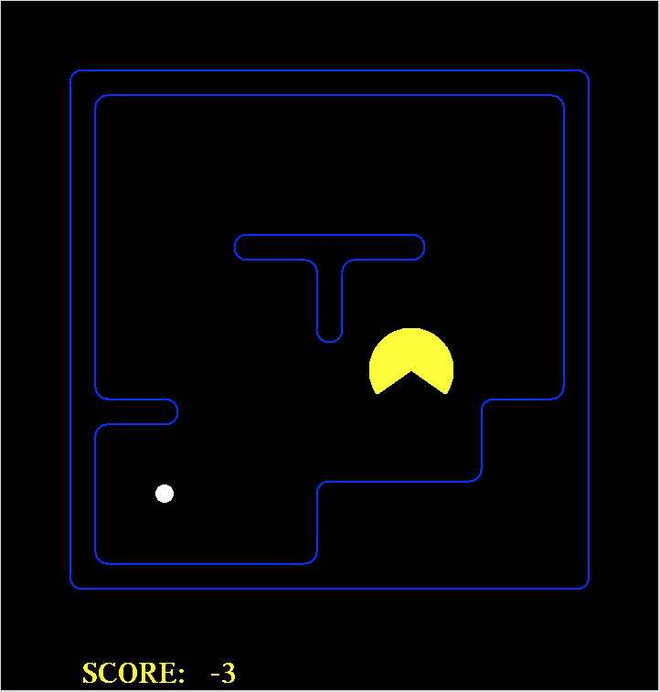
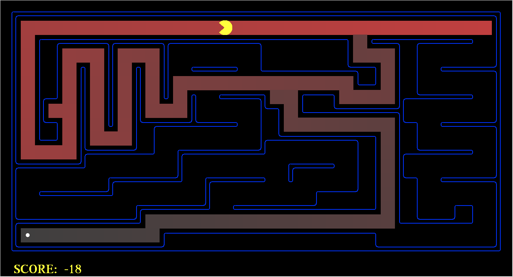

## Before you start

There is nothing to install. The handout and the search code import only the Python standard
library, so a Python 3.13 or newer interpreter is enough, as the manual requires.

```bash
python --version             # 3.13 or newer (use python3 if python is not found)
python pacman.py -h          # the full list of flags, with defaults
```

Unzip the handout wherever you like and run everything from inside it, rather than from the folder
above it: `layouts/` is opened relative to the working directory, and the autograder loads `search.py`
and `searchAgents.py` from where you stand.

The window is the one thing that can need an extra package. `tkinter` is part of the standard library,
but some Linux distributions ship it separately (`python3-tk` on Debian and Ubuntu). If the window
does not open, everything still works with `-t` or `-q`.

## Three ways to look at a run

| how | flag | what you get |
|---|---|---|
| window | none | the board, Pacman walking the plan, and the expansion trail |
| terminal | `-t` | the same game drawn as ASCII, one board per step |
| nothing | `-q` | no display at all, just the summary lines |

`-q` gives the summary without a window, and the autograder works the same way, so the counts it
reports are the ones your code produces.

## Play it yourself

The default agent is `KeyboardAgent` and the default layout is `mediumClassic`.

```bash
python pacman.py                        # arrows or w/a/s/d, 'q' stops
python pacman.py -l smallClassic -z 2   # smaller board, twice the zoom
python pacman.py -l smallClassic --frameTime -1   # one frame per keypress
```

## Watch the algorithms

Exactly one agent runs before you write anything, and it is enough to see the board, the console and
the scoring:

```bash
python pacman.py -l tinyMaze -p SearchAgent -a fn=tinyMazeSearch
```

`tinyMazeSearch` lives in `search.py` and returns a hardcoded path, so it is valid on `tinyMaze` and
nowhere else. Everything else arrives with your code: until the function on the left exists, the
command stops with `*** Method not implemented: <name> at line N of search.py` and exit code 1. The
rows are cumulative, so each one assumes the rows above it already work.

| question | implement | then run `python pacman.py` with |
|---|---|---|
| `q1` | `depthFirstSearch` | `-l tinyMaze -p SearchAgent -a fn=dfs` |
| `q2` | `breadthFirstSearch` | `-l mediumMaze -p SearchAgent -a fn=bfs` |
| `q3` | `uniformCostSearch` | `-l mediumMaze -p SearchAgent -a fn=ucs` |
| `q3` | `uniformCostSearch` | `-l mediumDottedMaze -p StayEastSearchAgent`, then `-l mediumScaryMaze -p StayWestSearchAgent` |
| `q4` | `aStarSearch` | `-l mediumMaze -p SearchAgent -a fn=astar,heuristic=manhattanHeuristic` |
| `q5` | the three `CornersProblem` methods | `-l mediumCorners -p SearchAgent -a fn=bfs,prob=CornersProblem` |
| `q6` | `cornersHeuristic` | `-l mediumCorners -p AStarCornersAgent -z 0.5` |
| `q7` | `foodHeuristic` | `-l testSearch -p AStarFoodSearchAgent` |
| `q8` | `findPathToClosestDot` | `-l bigSearch -p ClosestDotSearchAgent -z 0.5` |

The two `Stay...` agents differ only in their cost function, which is why uniform-cost search ends up
on the opposite side of the board in each. The last four rows are the two problems of the assignment,
and they are what the higher grades ask for.

## What you are looking at

The first run, before you write anything, opens a window like this one — `tinyMaze` with
`tinyMazeSearch`, a few steps in:



and prints this in the terminal:

```
[SearchAgent] using function tinyMazeSearch
[SearchAgent] using problem type PositionSearchProblem
Path found with total cost of 8 in 0.0 seconds
Search nodes expanded: 0
```

Eight actions and zero expansions: `tinyMazeSearch` returns a hardcoded list, so no state was ever
generated and nothing was searched. Those two numbers are the scoreboard for the whole task — once
your own search is in, cost and expansion count are what you compare between algorithms.

The plan is computed once, at the start of the game, and then replayed one action at a time. After
that, nothing is being searched any more; you are watching a list of actions.

Once a search of yours is in, the board also fills in the **expansion order**, bright red for the
squares expanded first and dark red for the last ones. This is `mediumMaze` with depth-first search,
partway through the walk:



The shading is not animated: it appears all at once, when the search finds its goal, and Pacman sets
off only after that. It is also only drawn for a plain path-finding run like this one — on
`mediumCorners` and the food layouts you see the walk and no shading.

## What your code talks to

Every search function in `search.py` receives a `problem` object and must return a **list of actions**
(strings like `['South', 'West', 'West']`), **not** a list of `(x, y)` states.

| call on `problem` | what it returns |
|---|---|
| `problem.getStartState()` | the initial state (in `PositionSearchProblem` a `(x, y)` pair; in later tasks whatever you design) |
| `problem.isGoalState(state)` | `True` if `state` is a goal, `False` otherwise |
| `problem.getSuccessors(state)` | a list of `(nextState, action, stepCost)` triples |
| `problem.getCostOfActions(actions)` | total cost of a list of actions from the start state |

For the frontier, use the data structures in `util.py` rather than Python lists or `heapq`:

| class in `util.py` | push | pop | empty check |
|---|---|---|---|
| `util.Stack()` | `s.push(item)` | `s.pop()` | `s.isEmpty()` |
| `util.Queue()` | `q.push(item)` | `q.pop()` | `q.isEmpty()` |
| `util.PriorityQueue()` | `pq.push(item, priority)` | `pq.pop()` | `pq.isEmpty()` |

Always loop with `while not frontier.isEmpty():`. Writing `while frontier:` is always `True` on these
classes and will pop from an empty structure.

## Flags worth knowing

| flag | meaning |
|---|---|
| `-l NAME` | layout from `layouts/NAME.lay`, for example `-l mediumCorners` |
| `-p TYPE` | agent class from any of the `*Agents.py` files in the handout: `searchAgents.py`, `pacmanAgents.py`, `ghostAgents.py`, `keyboardAgents.py` |
| `-a ARGS` | arguments for that agent, comma separated with no spaces: `-a fn=astar,heuristic=manhattanHeuristic` |
| `-z X` | zoom, `2` is twice the size |
| `--frameTime X` | seconds per frame; `0` as fast as it can, negative waits for a key |
| `-t` / `-q` | ASCII display / no display |
| `-f` | fix the random seed, so the same command repeats exactly |
| `-n N` | play N games and report the average |
| `-g TYPE`, `-k N` | ghost agent and how many ghosts (search layouts have none) |
| `--timeout N` | seconds an agent may spend on one game before it is killed |

## The loop you will actually work in

1. Edit `search.py` or `searchAgents.py` only. Everything else is supplied and must stay as it is.
2. Watch it once on a small layout, for example
   `python pacman.py -l tinyMaze -p SearchAgent -a fn=bfs`.
3. Check the question: `python autograder.py -q q2`.
4. Before handing in: `python autograder.py`, with no arguments, all eight questions.

The autograder builds its own game states and calls your functions directly, so it needs no display
and is not affected by anything you pass to `pacman.py`. If a single test fails, the autograder prints
its `test_cases/qN/...` path; you can re-run just that test with, for example,
`python autograder.py -t test_cases/q1/graph_backtrack`.

## When it breaks

| message | cause |
|---|---|
| `AttributeError: foo is not a search function in search.py.` | the name after `fn=` does not exist; the aliases are `dfs`, `bfs`, `ucs`, `astar` |
| `AttributeError: Foo is not a search problem type in SearchAgents.py.` | the name after `prob=` must be a class that ends in `Problem` |
| `_tkinter.TclError` or no window appears | no display: use `-t` for ASCII or `-q` for numbers only |
| `Warning: this does not look like a regular search maze` | the layout is not a single-dot search board, so the default goal at `(1,1)` is a guess; such a run can also never end, because Pacman stops while dots are left, so interrupt it with `Ctrl-C` |
| `IndexError: pop from empty list` (or `pop from an empty priority queue`) | you wrote `while frontier:` instead of `while not frontier.isEmpty():`, or the maze has no solution |
| `Exception: Illegal move (5, 4)` (or `KeyError: (5, 4)`) | your search returned a list of states `[(5, 4), ...]` instead of a list of actions `['North', ...]` |
| `TypeError: unhashable type: 'list'` | you tried to add a `list` to a `set()` (your `visited` set): in `CornersProblem` (`q5`), every part of a state must be immutable (use a `tuple`, not a `list`) |
| `Exception: findPathToClosestDot returned an illegal move` | the returned path walks into a wall or off the board |
| `Exception: Command line input not understood: [...]` | an unknown flag, or spaces inside `-a` where commas belong |
| `*** Method not implemented: depthFirstSearch at line N of search.py` | that stub is still empty; the message names the function to write |

Search runs are deterministic: the same command gives the same node counts every time, so a count that
moves means the code moved. `-f` fixes the random seed, which matters only for the ghost layouts,
where scores otherwise differ from run to run.

## Further watching

- [Search — Lecture 0, CS50's Introduction to Artificial Intelligence with Python](https://youtu.be/WbzNRTTrX0g)
- [Dijkstra's Algorithm — Computerphile](https://youtu.be/GazC3A4OQTE)
- [A* Search Algorithm — Computerphile](https://youtu.be/ySN5Wnu88nE)